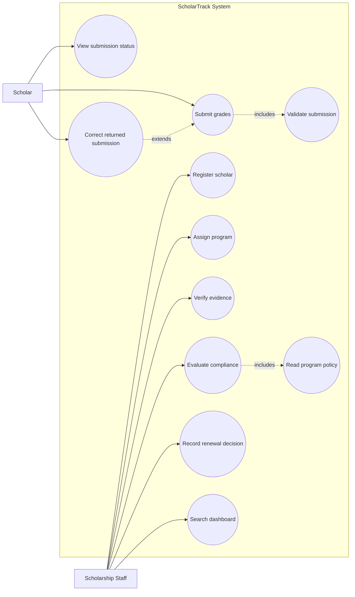
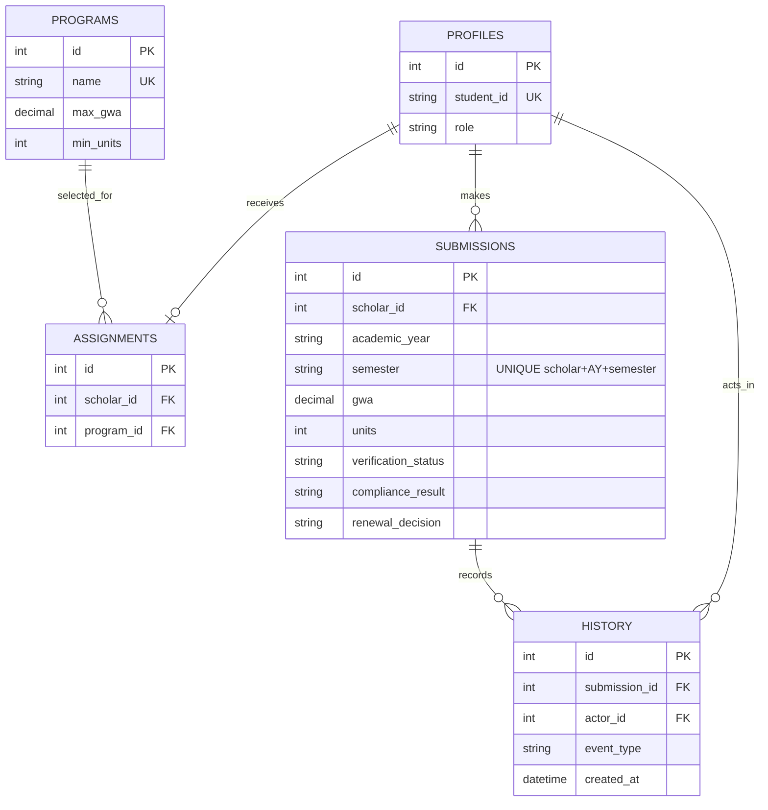

# ScholarTrack — Analysis and Design Baseline

## A1 Investigation and planning

**Problem statement.** Scholarship renewal work combines disconnected spreadsheets, email attachments, and paper grade records. This causes incomplete evidence trails and delayed, inconsistent decisions. ScholarTrack records a scholar's semester academic summary, evidence reference, verification, policy evaluation, and staff decision in one role-controlled system; it does not replace the Registrar as official-grade source.

| ID | Cause | Effect |
|---|---|---|
| PC01 | Semester records are kept in separate files | Duplicate or missing submissions |
| PC02 | Evidence is emailed or paper-based | Verification status is unclear |
| PC03 | Policy thresholds are applied manually | Inconsistent compliance outcomes |
| PC04 | Decisions have no shared history | Delayed renewal and weak accountability |

Scope: Scholar submission/correction and status visibility; staff registration/assignment, evidence verification, policy evaluation, renewal decision, dashboard/search/history. Exclusions: Registrar integration, official-grade changes, payments, SMS, ML, exceptions, and full appeals.

Development tasks: DT01 model SQLite records and seed policies; DT02 implement authenticated role APIs; DT03 build scholar submission/correction screens; DT04 build staff dashboard and test evidence. Risks: R01 network/hosting failure → local PHP/SQLite run instructions; R02 accidental policy divergence → thresholds are read from persisted program records, never duplicated in UI logic.

## A2 Stakeholders and elicitation

Stakeholders: Scholars (actual actor), Scholarship Staff (actual actor), Registrar (information source, not system actor), Scholarship Office Manager (policy owner/report consumer).

1. How should staff decide that a grade-document reference has adequate evidence?
2. What happens when a scholar submits close to or after the stated deadline?
3. Which exceptions may a manager authorize, and should they remain outside the MVP?
4. Which staff members require access to all scholar submissions and history?
5. What information must a scholar see when evidence is returned for correction?
6. Which semester/program/compliance reports do office managers need?

## A3 Requirements and rules

| ID | Testable functional requirement |
|---|---|
| FR01 | The system authenticates Scholar and Staff roles. |
| FR02 | A scholar can read only their own submissions and history. |
| FR03 | Staff can register a scholar and assign a persisted program. |
| FR04 | A scholar submits AY, semester, GWA, counts, and evidence reference. |
| FR05 | The system rejects duplicate scholar/AY/semester submissions. |
| FR06 | Staff mark evidence Verified or Returned with a return reason. |
| FR07 | A returned record can be corrected and resubmitted as Pending. |
| FR08 | Staff evaluate only Verified records using selected-program thresholds. |
| FR09 | Staff explicitly approve or hold a renewal with notes. |
| FR10 | Staff can search/filter and view dashboard counts and change history. |

NFR01: role-denied API requests return HTTP 403. NFR02: input validation rejects GWA outside 1.00–5.00 and negative counts before persistence. NFR03: page is usable at 320px width. NFR04: each state change stores actor and ISO timestamp.

BR01: one submission is unique per scholar + AY + semester. BR02: GWA/counts are within stated valid ranges. BR03: deadline is Asia/Manila and exactly 17:00 is on time. BR04: missing/unverified evidence blocks evaluation. BR05: failed condition or lateness yields With Deficiency with reasons. BR06: only Staff can decide renewal; approval requires Verified + Compliant, while a flag does not automatically disqualify (staff may Hold).

## A4 Use case model

UC01 Submit Grades includes Validate Submission because every submission must be validated. UC02 Evaluate Compliance includes Read Program Policy because it must obtain thresholds. UC03 Correct Returned Submission extends Submit Grades at the conditional returned-for-correction point.

## A5 Detailed use cases and ERD

**UC01 Submit Grades** — Actor: Scholar. Trigger: scholar selects submission. Preconditions: authenticated scholar, assignment exists. Main flow: 1) enter AY/semester, academic values, evidence reference; 2) system validates ranges and unique key; 3) saves timestamp and Pending verification; 4) logs Submitted; 5) shows receipt. Alternatives: duplicate → reject; invalid values/reference missing → explain field error. Exception: persistence error → preserve input and report error. Postcondition: one Pending submission exists. Links: FR02, FR04, FR05, FR07; BR01, BR02.

**UC02 Evaluate Compliance** — Actor: Staff. Trigger: staff selects Evaluate. Preconditions: authenticated staff; submission has Verified evidence. Main flow: 1) load assigned program; 2) compare GWA, units, failed, incomplete, dropped, and deadline; 3) save Compliant or With Deficiency plus reasons; 4) log event; 5) display result. Alternative: any failed/late condition produces deficiency reasons. Exception: Pending/Returned evidence blocks evaluation. Postcondition: evaluation is persisted; award is unchanged. Links: FR08; BR03–BR05.

## A6 Traceability and results

| FR | Actor / UC | BR | Implemented screen/function | Test / expected result |
|---|---|---|---|---|
| FR02 | Scholar / View status | BR06 | `list`, `history` APIs | TC08: another scholar's data denied |
| FR05 | Scholar / Submit Grades | BR01 | unique DB key + `submit` | TC07: duplicate rejected clearly |
| FR08 | Staff / Evaluate Compliance | BR03–BR05 | `evaluate` API | TC01–TC06 results match rules |
| FR09 | Staff / Record decision | BR06 | `decide` API | TC10: compliant approves; deficient holds |

Planned but not implemented: policy exception/appeal workflow (explicitly outside examination scope).

| Test | Expected / actual (seeded) | Status | Evidence |
|---|---|---|---|
| TC01 | A01 Compliant at exact GWA/deadline | Pass | Staff review → Evaluate |
| TC02 | A02 With Deficiency: GWA | Pass | Staff review → Evaluate |
| TC03 | A03 Compliant; one drop allowed | Pass | Staff review → Evaluate |
| TC04 | A04 deficiency: units and INC | Pass | Staff review → Evaluate |
| TC05 | A05 deficiency: failed and late | Pass | Staff review → Evaluate |
| TC06 | A06 evaluation/approval blocked while Pending | Pass | Staff review controls |
| TC07 | Duplicate/invalid input rejected | Pass | Scholar submission form/API |
| TC08 | Cross-scholar reading/verification denied | Pass | Session-guarded API |
| TC09 | Returned correction becomes Pending and history persists | Pass | Scholar correction + history |
| TC10 | Staff approves compliant / holds deficient | Pass | Staff review decision controls |
